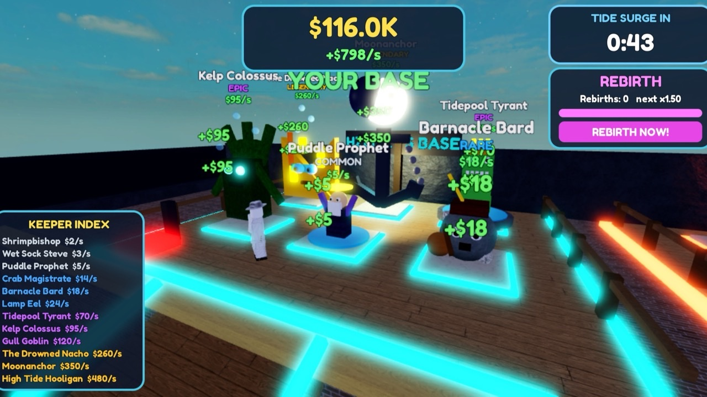

# Brainrot Tide Keepers

An entry for make.fun's [Make the best AI Roblox brainrot game](https://make.fun/bounty/roblox-brainrot-01) bounty.

A flooded harbour market at dusk, where absurd meme-born creatures wash in with the tide. Buy a tide-keeper at the
Tide Stall, carry it up the ramp to your base on the high ground, and it earns money every second. Steal keepers
from the rival harbour gangs, lock your own base, rebirth for a permanent multiplier, and every 90 seconds run
for high ground before the **tide surge** floods the market and swallows whatever you are carrying.

## The cast: 12 keepers, 4 rarities

| Rarity | Keeper | Price | Earns |
|---|---|---|---|
| Common | Shrimpbishop, Wet Sock Steve, Puddle Prophet | $40 to $90 | $2 to $5/s |
| Rare | Crab Magistrate, Barnacle Bard, Lamp Eel | $400 to $750 | $14 to $24/s |
| Epic | Tidepool Tyrant, Kelp Colossus, Gull Goblin | $2,500 to $4,200 | $70 to $120/s |
| Legendary | The Drowned Nacho, Moonanchor, High Tide Hooligan | $9,000 to $16,000 | $260 to $480/s |

Every purchase has a 2% chance of a **Golden mutation**: a gold-sparkling keeper that earns double.

## How it plays

- **Buy**: hold E at a stall pedestal; the server checks your money and distance.
- **Carry and place**: the keeper rides above your head; press E on an empty slot of your base.
- **Earn**: each placed keeper pays its rate every second, with a floating "+$" over it.
- **Steal**: hold E on someone else's keeper; a bought **Lock** (red pad) raises a barrier that bounces thieves.
- **Rebirth**: at $10,000, reset money and keepers for a permanent x1.5 income multiplier (stacking).
- **Tide surge**: a 10-second warning, then the water rises over the low market for 15 seconds. Anyone below
  the high ground takes damage and loses the keeper they carry.

## Layout

- `src/shared/`: `Brainrots` (catalogue), `BrainrotModels` (block-built bodies and labels), `Economy`, `Tide`, `Config`
- `src/server/`: `init.server` bootstrap, `State` (the single source of truth for player state), `PlotService`,
  `PurchaseService`, `CarryService`, `StealService`, `RebirthService`, `TideService`, `Remotes`
- `src/client/`: `Game.client` bootstrap, `HUD`, `Effects`, `TideWarning`
- `tools/build_world.py` writes the 3D harbour into `default.project.json`; `tools/studio_mcp.py` drives Roblox
  Studio's MCP server for play-tests and captures.

Build and hand in:

    python3 tools/build_world.py && rojo build default.project.json --output game.rbxl
    mkdir -p out && MAKEFUN_OUTPUT_DIR=out node main.ts
